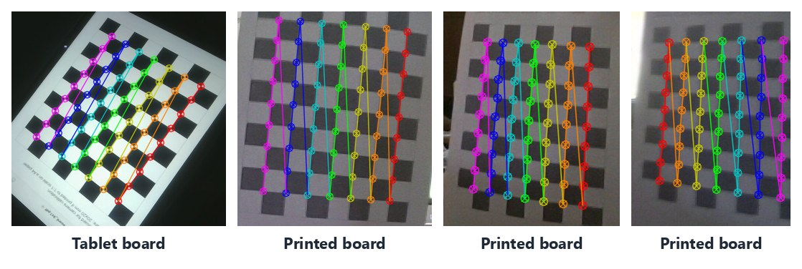
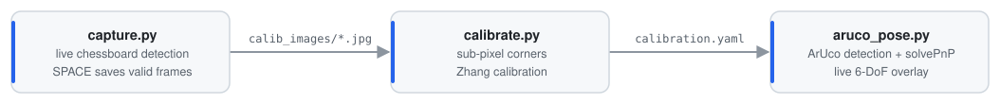
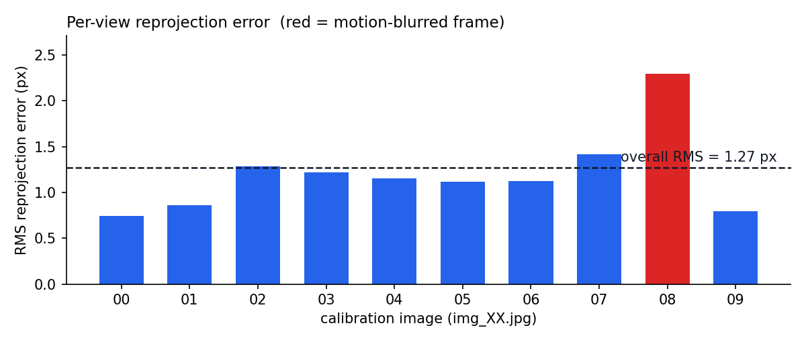
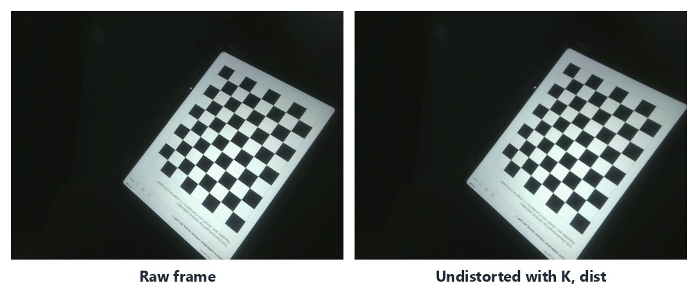

# 01 · Camera Calibration & ArUco Pose Estimation

> Calibrate a real webcam from scratch, then use the calibration to track a fiducial marker in 6-DoF in real time.


<sub>Sub-pixel chessboard corners detected on my calibration set (9×7 inner corners, 63 points per view). Crops show the board only.</sub>

## At a glance

| | |
|---|---|
| **Goal** | Recover the intrinsics *K* and lens distortion of a laptop webcam, then estimate the 3D pose of an ArUco marker live |
| **Data** | 10 self-captured 640×480 views of a 9×7 chessboard (16.5 mm squares); the board was detected in all 10 |
| **Result** | RMS reprojection error **1.27 px**; *f<sub>x</sub>* = 587.5 px, *f<sub>y</sub>* = 588.9 px (horizontal FoV ≈ 57°) |
| **Stack** | Python · OpenCV (`calibrateCamera`, `cornerSubPix`, `aruco.ArucoDetector`, `solvePnP`) · NumPy · PyYAML |

## What I built

A three-stage tool chain where each script hands its output to the next:

<p align="center">
  <picture>
    <source media="(prefers-color-scheme: dark)" srcset="assets/pipeline-dark.svg">
    
  </picture>
</p>

1. **`capture.py`**: streams the webcam, runs `findChessboardCorners` on every frame and only lets you save a frame (SPACE) once the full 9×7 grid is found, so no unusable views end up in the dataset.
2. **`calibrate.py`**: builds the metric 3D grid (Z = 0 plane, 16.5 mm pitch), refines every corner to sub-pixel accuracy (`cornerSubPix`, 11×11 window, 30 iterations / ε = 0.001), runs Zhang's method through `cv2.calibrateCamera` with the 5-term Brown–Conrady model, grades the RMS error and writes `calibration.yaml`.
3. **`aruco_pose.py`**: loads the calibration, detects `DICT_4X4_250` markers with the OpenCV ≥ 4.7 `ArucoDetector` API, solves Perspective-n-Point against a 9.4 cm marker model, converts the Rodrigues vector to roll/pitch/yaw (with gimbal-lock handling) and overlays the axes, distance and XYZ position on the live feed.

## The model being estimated

A 3D point $\mathbf{X}_w$ projects to pixel $\tilde{\mathbf{x}}$ through the extrinsics $[R\,|\,\mathbf{t}]$ and intrinsics $K$:

$$
\tilde{\mathbf{x}} \;=\; K\,[R \mid \mathbf{t}]\,\tilde{\mathbf{X}}_w,
\qquad
K=\begin{bmatrix} f_x & s & c_x\\ 0 & f_y & c_y\\ 0&0&1\end{bmatrix}
$$

Lens distortion is modelled with radial $(k_1,k_2,k_3)$ and tangential $(p_1,p_2)$ terms. Calibration solves for $K$, the distortion vector and one $[R\,|\,\mathbf{t}]$ per view by minimising the reprojection error over all 630 detected corners.

## Results

**Recovered intrinsics** (`calibration.yaml`, reproducible by re-running `calibrate.py` on the committed images):

| Parameter | Value | | Parameter | Value |
|---|---|---|---|---|
| $f_x$ | 587.54 px | | $k_1$ | −0.2329 |
| $f_y$ | 588.91 px | | $k_2$ | 0.4177 |
| $c_x$ | 245.45 px | | $p_1$ | 0.0142 |
| $c_y$ | 236.70 px | | $p_2$ | 0.0081 |
| RMS error | **1.273 px** | | $k_3$ | −0.4072 |

<p align="center"></p>

The per-view breakdown shows exactly where the error comes from. Most views sit near 0.75 to 1.3 px, and the worst (`img_08`, 2.30 px) is a visibly motion-blurred frame. $f_x/f_y \approx 0.998$ confirms near-square pixels.

<p align="center"></p>
<p align="center"><sub>Applying the recovered model with <code>cv2.undistort</code>. The tablet edges straighten toward the image border, where radial distortion is strongest.</sub></p>

### What I'd do differently

The diagnostics point to clear next steps:
- **Principal point:** $c_x$ sits about 75 px off the image centre.
- **Distortion terms:** the large, opposite-signed $k_2/k_3$ pair is a classic sign that 10 fairly fronto-parallel views under-constrain the model.
- **Fixes:** capture 15 to 20 sharper, more steeply tilted views, drop blurred frames, or fix $k_3$ (`CALIB_FIX_K3`). Any of these should push the error well below 1 px.
- **Marker pose:** switching `solvePnP` to `SOLVEPNP_IPPE_SQUARE`, which is purpose-built for square markers, would make pose estimates more stable.

## Run it

```bash
pip install -r requirements.txt
cd 01-camera-calibration-pose
python calibrate.py      # works offline on the committed images and reproduces calibration.yaml
python capture.py        # webcam + printed 9x7 chessboard: SPACE = save, ESC = quit
python aruco_pose.py     # webcam + printed DICT_4X4_250 marker (9.4 cm): q/ESC = quit, p = print pose
```

Generate ArUco markers at [chev.me/arucogen](https://chev.me/arucogen/) (dictionary 4×4, ID 0 to 249). If you print yours at a different size, update `MARKER_SIZE` in `aruco_pose.py`. The scripts read relative paths, so run them from inside this folder.

## Files

```
01-camera-calibration-pose/
├── capture.py                      # interactive calibration-image capture
├── calibrate.py                    # Zhang calibration → calibration.yaml
├── aruco_pose.py                   # real-time 6-DoF marker pose
├── calibration.yaml                # recovered K, distortion, RMS
├── calib_images/                   # the 10 calibration views
├── camera_calibration_class.ipynb  # lab guide: pinhole model, intrinsics/extrinsics, distortion, PnP
├── notebook_images/                # projection diagrams used by the notebook (course slides)
├── opencv_primer_scripts/          # OpenCV warm-up snippets (I/O, drawing, grayscale, Canny)
└── assets/                         # README figures
```

## Skills demonstrated

`camera intrinsics & extrinsics` · `Zhang's planar calibration` · `Brown–Conrady distortion` · `sub-pixel corner refinement` · `reprojection-error analysis` · `fiducial (ArUco) detection` · `Perspective-n-Point` · `rotation representations (axis-angle → matrix → Euler)` · `real-time video pipelines`
