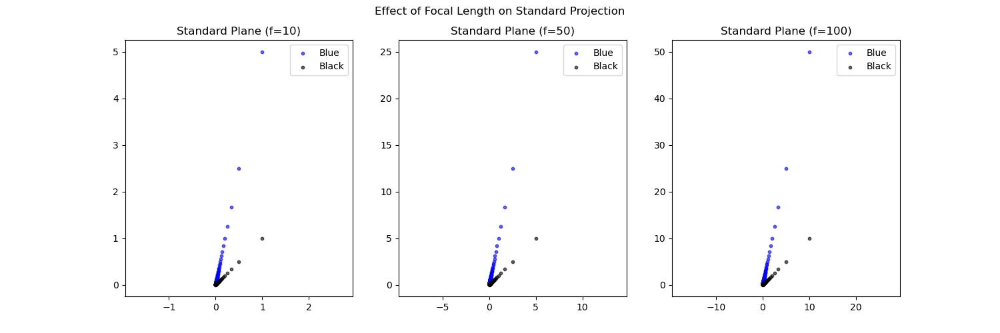
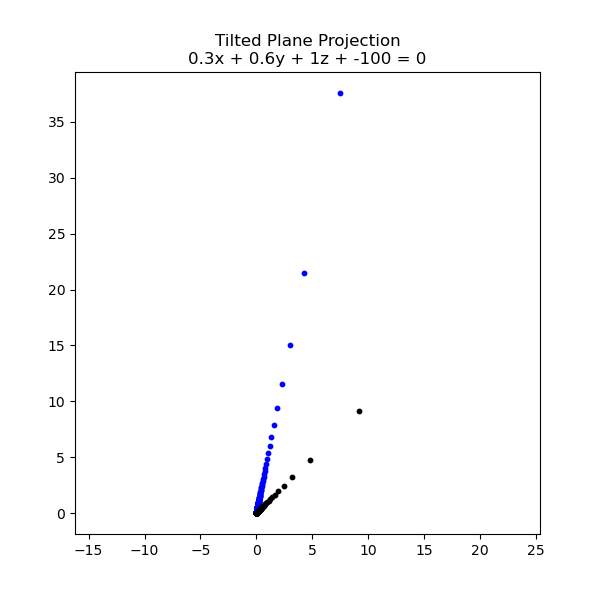
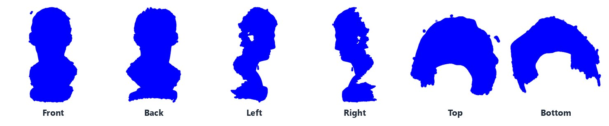
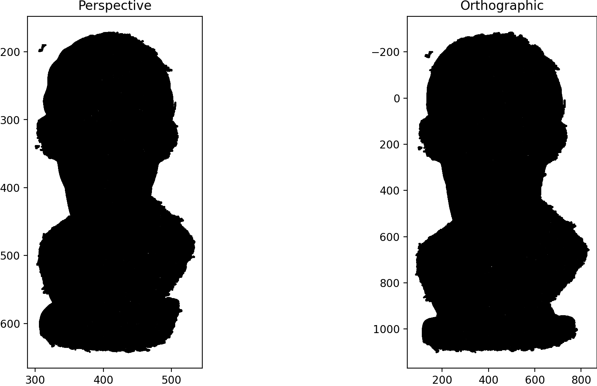
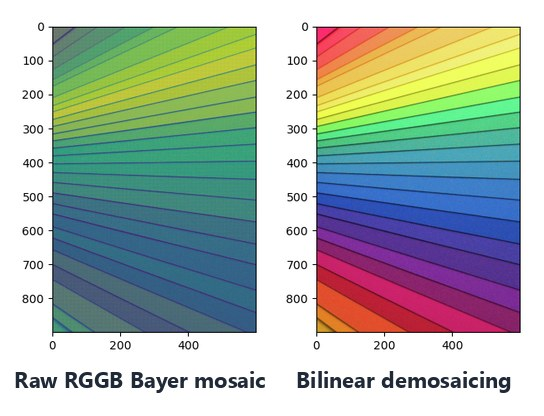

# 02 · Image Formation: Pinhole Projection, 3D Scan Rendering & Demosaicing

> A virtual camera built from first principles in NumPy: ray–plane intersection, a look-at camera that renders a real 3D scan from any viewpoint, and a Bayer demosaicer. No graphics library involved.

<table>
<tr>
<td width="34%" align="center"><br><sub>120-frame camera orbit, depth-coloured</sub></td>
<td width="66%" align="center"><br><sub>Perspective render of a 314k-point Revopoint scan. Near points are dark purple, far points yellow (viridis).</sub></td>
</tr>
</table>

## At a glance

| | |
|---|---|
| **Part I: Pinhole model** | Projected 2 × 1,000,000 synthetic 3D points onto a standard plane (Z = f) and an arbitrarily tilted plane; studied focal length and "ideal points" |
| **Part II: Rendering** | Implemented world→camera→pixel projection with a look-at rotation; rendered six canonical views of a 3D scan, plus my own scan of a spectacles case |
| **Bonus** | Depth colouring, a 360° camera orbit (120 frames), perspective vs orthographic |
| **Part III: Demosaicing** | Bilinear RGGB interpolation of a 900×600 raw Bayer image |
| **Stack** | Python · NumPy (fully vectorised geometry) · Matplotlib · plyfile · Pillow |
| **Write-up** | [14-page technical report](report/technical_report.pdf) with derivations and analysis |

## Part I: Pinhole camera and projection planes

With the camera centre at **C**, every 3D point **P** defines a ray $\mathbf{R}(t) = \mathbf{C} + t(\mathbf{P}-\mathbf{C})$. The image point is where that ray meets the image plane:

| Image plane | Intersection |
|---|---|
| Standard plane $Z = f$ | $t = f/z \;\Rightarrow\; (x', y') = \left(\dfrac{f\,x}{z},\ \dfrac{f\,y}{z}\right)$ |
| Tilted plane $\mathbf{n}^\top\mathbf{X} + d = 0$ | $t = -\dfrac{\mathbf{n}^\top\mathbf{C} + d}{\mathbf{n}^\top(\mathbf{P}-\mathbf{C})}$ (rays with $\lvert\mathbf{n}^\top\mathbf{V}\rvert < 10^{-6}$ are rejected) |

Image coordinates then map to pixels via the principal point, $u = x' + c_x,\; v = y' + c_y$.

<p align="center"></p>
<p align="center"><sub>Two parallel 3D lines, x = 1 with y = 1 and with y = 5, for z from 10 to 10<sup>7</sup>, projected at f = 10, 50 and 100. Image size scales linearly with f, and both lines converge to the same vanishing point.</sub></p>

**Ideal points.** Comparing the 3D gap between corresponding points on the two lines with their projected gap:

| Point pair | 3D distance | Standard plane (f = 50) | Tilted plane 0.3x + 0.6y + z − 100 = 0 |
|---|---|---|---|
| Nearest (z = 10) | 4.0 | **20.0** (×5 = f/z) | **32.93** (×8.23) |
| Farthest (z = 10⁷) | 4.0 | 2 × 10⁻⁵ → 0 | → 0 |

Far points collapse onto the vanishing point and behave like points at infinity. The tilted plane breaks the uniform f/z scaling: magnification varies across the image and is stretched far more in *y* than *x*.

<p align="center"></p>

## Part II: Rendering a 3D scan with a virtual camera

The scan is treated as a fixed world, and only the camera moves. For a camera at **C** looking at target **T**:

$$
\mathbf{f}=\frac{\mathbf{T}-\mathbf{C}}{\lVert\mathbf{T}-\mathbf{C}\rVert},\quad
\mathbf{r}=\frac{\mathbf{f}\times\mathbf{up}}{\lVert\mathbf{f}\times\mathbf{up}\rVert},\quad
\mathbf{d}=\mathbf{f}\times\mathbf{r},\qquad
R=\begin{bmatrix}\mathbf{r}^\top\\ \mathbf{d}^\top\\ \mathbf{f}^\top\end{bmatrix},\quad
\mathbf{P}_c = R(\mathbf{P}_w-\mathbf{C})
$$

Points with $Z_c > 0$ are projected with $K = \begin{bmatrix}800&0&512\\0&800&512\\0&0&1\end{bmatrix}$ onto a 1024×1024 image. The camera is placed at ±2 × the object's extent along each axis, with the up-vector switched for the top and bottom views to avoid a degenerate cross product.


<sub>Six canonical views of the 314,016-vertex bust scan, produced purely by moving the camera. Top and bottom show a horseshoe because the scan is an open shell.</sub>

I repeated this on **my own Revopoint 3D scan** (a spectacles case, 143,619 vertices); the renders are in [`results/views/*_2.png`](results/views/).

## Bonus: depth, orbit and projection models

- **Depth colouring:** 200k subsampled points normalised to the unit sphere and coloured by camera-space depth $Z_c$ (hero image above).
- **Camera orbit:** $\mathbf{C}(\theta) = (3\cos\theta,\ 0.5,\ 3\sin\theta)$ for θ in 3° steps, rendered as 120 depth-coloured frames ([`results/orbit_frames/`](results/orbit_frames/)) and looped in the GIF above.
- **Perspective vs orthographic:** $(X_c/Z_c,\ Y_c/Z_c)$ vs $(X_c,\ Y_c)$ from the same pose. Perspective enlarges the nearer head relative to the shoulders, while orthographic preserves relative size.

<p align="center"></p>

## Part III: Bilinear demosaicing

A single-sensor camera records one colour per pixel through an RGGB colour filter array. Each missing channel is the average of the nearest samples of that colour:

| Site | Green estimate | Red / blue estimate |
|---|---|---|
| R pixel | mean of 4 edge neighbours | B = mean of 4 diagonals |
| G pixel (red row) | — | R = left/right mean, B = up/down mean |
| G pixel (blue row) | — | R = up/down mean, B = left/right mean |
| B pixel | mean of 4 edge neighbours | R = mean of 4 diagonals |

Borders average only the neighbours that exist.

<p align="center"></p>

The report discusses bilinear's characteristic artifacts: colour fringing, zippering at edges and loss of high-frequency detail. It also covers edge-directed and gradient-corrected (Malvar–He–Cutler) interpolation and learned demosaicing as improvements.

## Limitations & next steps

- **Orthographic scale:** the orthographic render isn't rescaled (magnification f instead of f/Z<sub>ref</sub>), so it appears about 3× larger than the perspective one.
- **Own-scan framing:** my spectacles-case renders reuse the bust's centroid and camera distance, so they come out off-centre. The fix is to recompute both per point cloud.
- **No z-buffer:** points are scatter-plotted without a depth test, so far points can paint over near ones. A z-buffer would fix this.
- **Speed:** `bayer2rgb` is a per-pixel Python loop; three 3×3 convolutions per CFA site would vectorise it.

## Run it

```bash
pip install -r requirements.txt
cd 02-image-formation-3d-projection
jupyter notebook image_formation.ipynb     # run all; outputs are written to results/
```

## Files

```
02-image-formation-3d-projection/
├── image_formation.ipynb       # all parts, end to end
├── data/
│   ├── points.pkl              # Part I: 2 × 1M synthetic 3D points
│   ├── scene.ply               # Part II: Revopoint scan of a bust (provided)
│   ├── mkoome_mesh.ply         # Part II: my own Revopoint scan (spectacles case)
│   └── data.pkl                # Part III: 900×600 RGGB Bayer mosaic
├── results/                    # figures, views/, orbit_frames/
├── report/technical_report.pdf
└── assets/                     # README figures (orbit GIF, montages)
```

## Skills demonstrated

`pinhole camera model` · `ray–plane intersection` · `vanishing & ideal points` · `look-at extrinsics` · `intrinsic matrix` · `point-cloud I/O and rendering` · `3D scanning` · `perspective vs orthographic projection` · `Bayer CFA demosaicing` · `vectorised NumPy` · `technical writing`
