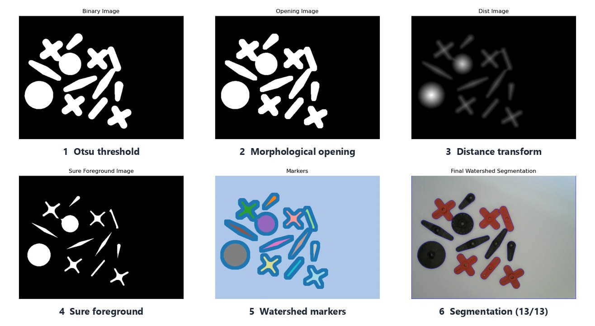
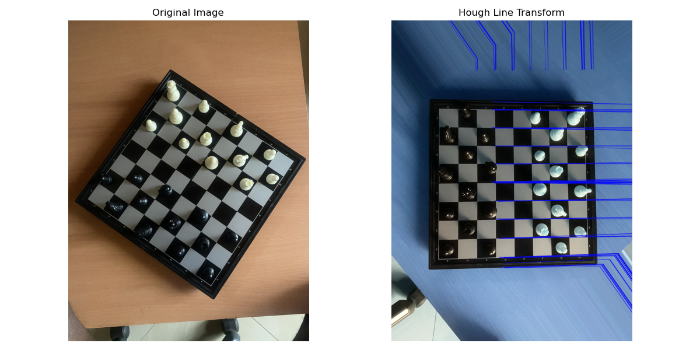
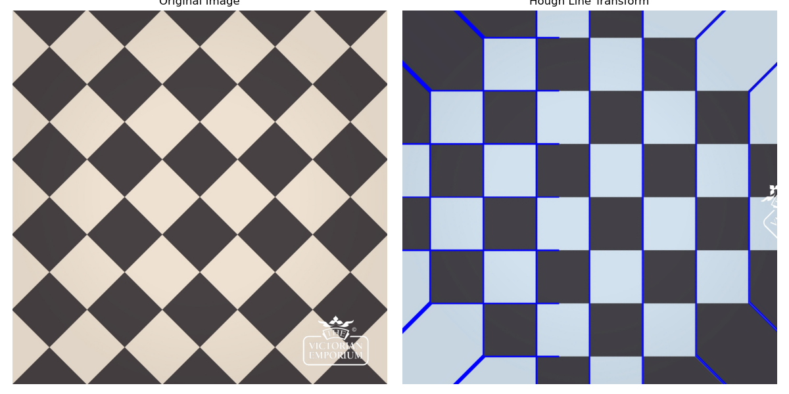
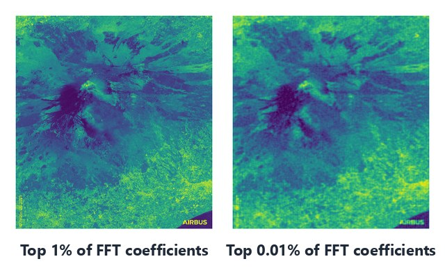
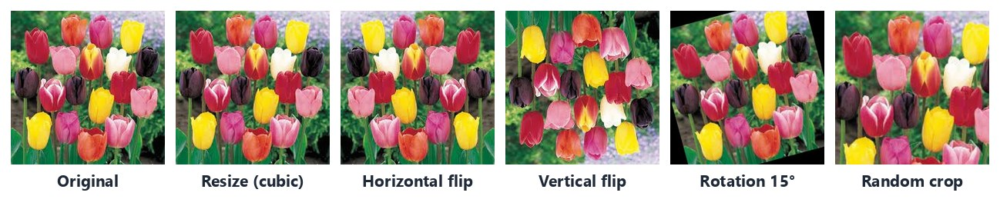

# 03 · Feature Detection, Segmentation & Frequency-Domain Processing

> Classical computer vision on four applied problems: counting touching objects for inventory, straightening a chessboard for a robot chess coach, compressing satellite imagery with the FFT, and augmenting data for face recognition.


<sub>Marker-controlled watershed separating 13 touching servo horns. A naive contour count merges them into 10.</sub>

## At a glance

| Problem | Technique | Result |
|---|---|---|
| **Q1** Count objects (inventory) | Otsu + morphology + distance transform + **watershed** | **13 / 13** on touching objects (naive Canny + contours: 10 / 13); 7 / 7 on separated objects |
| **Bonus** Count objects in video | Per-frame pipeline on a 26 s, 1080p CCTV clip | Failure analysis: unstable counts expose the limits of edge-based counting |
| **Q2** Straighten a chessboard | CLAHE → Sobel/Canny → **Hough transform** → dominant-angle rotation | Boards rotated 35° and 17° straightened; diamond tiles rotated 45° |
| **Q3** Compress satellite images | **2D FFT**, low-pass and top-k coefficient masks | 1% of coefficients keeps **30.2 dB** PSNR on a smooth portrait vs **19.4 dB** on texture-rich grass |
| **Q4** Augment face data | Resize, flips, rotation, shear, brightness, noise, random crop | Reusable `data_augmentation(img, type)` function |

**Stack:** Python · OpenCV · NumPy · Matplotlib

---

## Q1: Counting touching objects with watershed

**Baseline.** Grayscale → Gaussian blur (5×5) → Canny (50, 200) → external contours. This gets 7/7 on separated objects but only **10/13** when objects touch, because touching parts share one outer contour.

**Improved pipeline** (figure above):

1. Gaussian blur (9×9) → **Otsu** threshold → invert so objects are foreground.
2. **Morphological opening** (3×3 rect, 5 iterations) removes noise; closing fills holes.
3. **Distance transform** (L2): each pixel's value is its distance to the background, peaking at object centres.
4. **Sure foreground** = dist > 0.2·max; **sure background** = dilated mask; the band between them is "unknown".
5. `connectedComponents` on the sure foreground gives one seed per object, then `cv2.watershed` floods from the seeds and draws boundaries where floods meet.
6. Count = unique labels excluding the background and boundaries, giving **13/13**.

**On my own photo** (5 batteries and 2 paper clips) the same pipeline over-segments to 39. The printed labels on the batteries break each object into many fragments, a reminder that global thresholds are tuned to the scene they were built on.

### Bonus: counting on live video

Running the per-frame counter on a 26 s CCTV recording of 4 to 5 objects:

| Pipeline | Count range | Observation |
|---|---|---|
| Canny + contours | 3 to 21 (median 12) | Edges flicker with sensor noise and shadows; fragmented contours inflate the count |
| Watershed | constant 2 | The black pillarbox bars dominate the inverted mask and the distance-transform threshold |

The failure modes this exposes are frame-to-frame noise, shadows and reflections, objects partially leaving the frame, and letterbox borders. The fixes are to crop to the region of interest, apply temporal smoothing (e.g. a median over N frames) and use background subtraction.

---

## Q2: Chessboard straightening with the Hough transform



1. Gaussian blur → **CLAHE** (clip 2.0, 8×8 tiles) for contrast.
2. Edges from Canny, or from the **Sobel gradient magnitude** $\sqrt{G_x^2 + G_y^2}$ followed by Canny (100, 250).
3. `HoughLines` (ρ = 1 px, θ = 1°, threshold 250 to 300) parameterises each line as $\rho = x\cos\theta + y\sin\theta$.
4. A histogram of line angles gives the board's dominant orientation, and `warpAffine` rotates it to axis-aligned.

| Image | Dominant Hough angles | Correction |
|---|---|---|
| Chessboard (rotated about 35°) | 35°, 124°, 125° | −55° |
| Chessboard (rotated about 17°) | 17°, 20°, 19° | −73° |
| Diamond floor tiles | 135°, 45° | +45° (squares restored) |
| Busy pavement photo | 135°, 45°, 0° | fails: line flood |

Combining Sobel magnitude with Canny was more robust than Canny alone. The pavement image shows where it breaks down: with dense texture the Hough accumulator saturates and no single orientation dominates.

<p align="center"></p>

---

## Q3: Image compression in the frequency domain

Take the 2D FFT, keep only the strongest coefficients, then invert:

$$
F = \mathcal{F}\{I\},\qquad \hat I = \left|\,\mathcal{F}^{-1}\{F \cdot \mathbb{1}[\,|F| > \tau_k\,]\}\right|
$$

Here $\tau_k$ is the magnitude of the k-th largest coefficient. A first experiment with an ideal circular low-pass mask (radius 50 px) kept 1 in 1,112 coefficients at MSE 155.

| Image | Content | Coefficients kept | PSNR* |
|---|---|---|---|
| Portrait | smooth, low-frequency | 1% | **30.24 dB** |
| Portrait | | 0.1% | 27.64 dB |
| Grass | dense, high-frequency | 10% | 26.89 dB |
| Grass | | 1% | 19.36 dB |
| Satellite (Mt. Etna, 9744×8944) | mixed texture | 1% | 19.47 dB |
| Satellite | | 0.01% | 17.13 dB |

<sub>*PSNR of the reconstruction against the original grayscale image, computed in floating point. The values printed in the notebook were affected by a uint8 overflow in the MSE helper and are superseded by this table.</sub>

**Takeaway:** natural images concentrate energy in low frequencies, so smooth images survive aggressive truncation. Texture-heavy satellite and grass imagery spreads energy across the spectrum and degrades quickly. This is why practical codecs use local transforms (JPEG's 8×8 DCT) rather than one global FFT.

<p align="center"></p>

---

## Q4: Data augmentation for face recognition



`data_augmentation(img, type)` implements nearest/cubic resize to 224×224, horizontal and vertical flips, Gaussian blur with additive noise, a 15° rotation (a realistic head tilt), x/y shear (factor 0.2) on an enlarged canvas, HSV brightness shifts and random 80% crops.

---

## Limitations & next steps

- **Thresholds:** the watershed thresholds (Otsu + 0.2·max distance) are global. Adaptive thresholding or a learned instance segmenter (e.g. Mask R-CNN) would handle cluttered real scenes.
- **Overflow in augmentations:** brightness and noise are computed in `uint8` and wrap around on bright pixels. They should be computed in float and clipped.
- **Shear outputs:** the batch-save helper passes `shear_x`/`shear_y` keys that the function doesn't recognise, so the saved shear files are unmodified copies. The inline grid in the notebook shows the correct shear.
- **Colour display:** the Q2 figures display the Hough panel in BGR order, which causes the blue tint.

## Run it

```bash
pip install -r requirements.txt
cd 03-feature-detection-segmentation
jupyter notebook feature_detection.ipynb    # inputs in data/, outputs written to results/
```

Two cells use `cv2.imshow` and need a desktop session. The satellite FFT needs several GB of RAM.

## Files

```
03-feature-detection-segmentation/
├── feature_detection.ipynb
├── data/          # q1/ q2/ q3/ inputs, experiment.png, tiles.jpg, trial.jpg, satellite.jpg, tulips.jpeg, cctv_objects.mp4
├── results/       # pipeline stages, Hough figures, FFT reconstructions, augmented_images/, processed videos
└── assets/        # README figures
```

## Skills demonstrated

`Otsu thresholding` · `mathematical morphology` · `distance transform` · `marker-controlled watershed` · `contour analysis` · `Canny & Sobel edges` · `CLAHE` · `Hough line transform` · `affine rotation` · `2D FFT & spectral filtering` · `PSNR/MSE evaluation` · `data augmentation` · `video processing`
