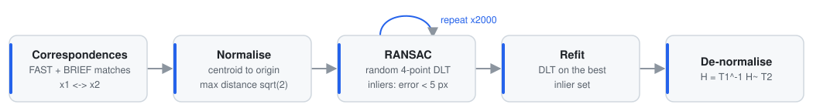
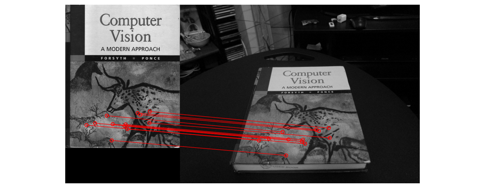
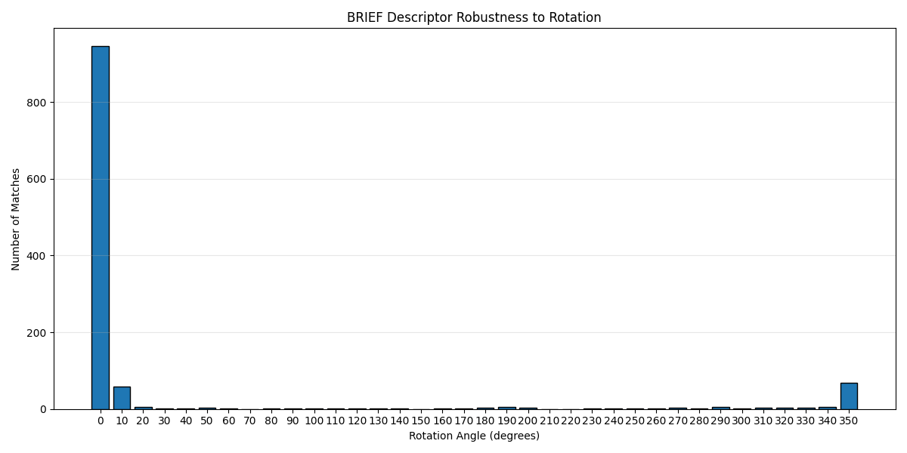
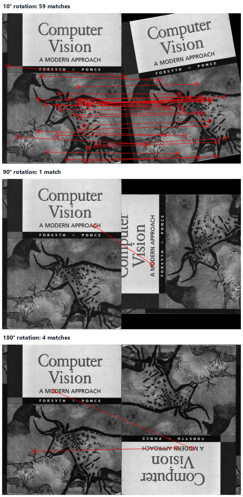
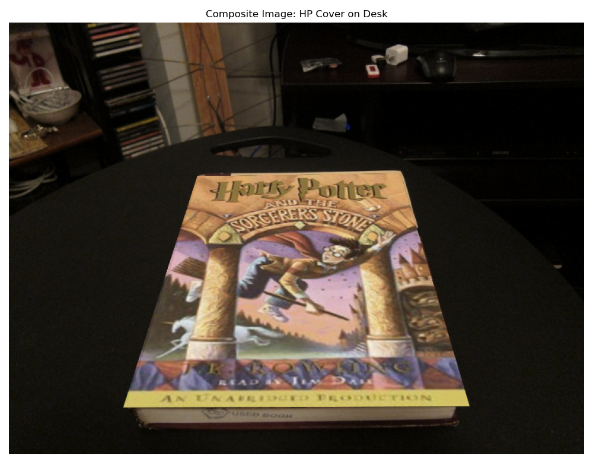
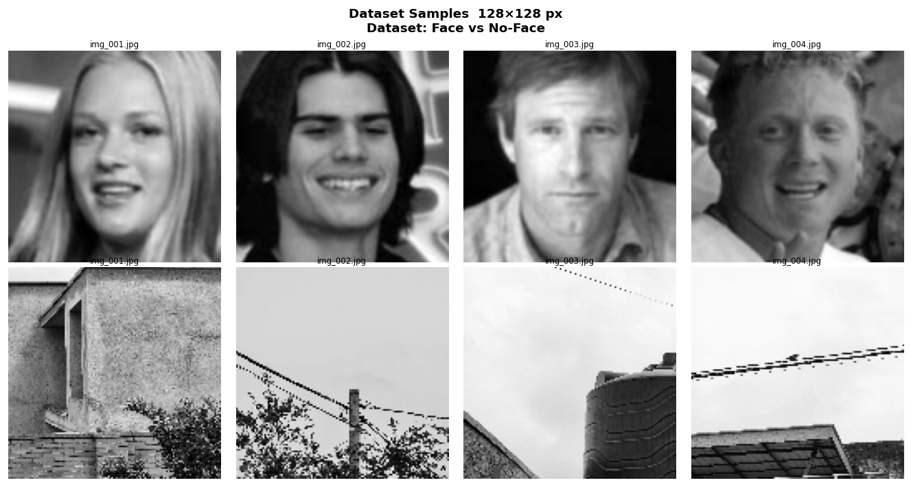
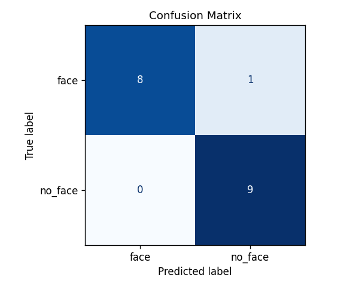

# 04 · Augmented Reality with Planar Homographies

> A classical AR pipeline written from the math up. It detects and matches features, estimates a homography with my own DLT + RANSAC implementation, and composites a video onto a moving book, frame by frame.

<p align="center">
  
  &nbsp;
  
</p>
<p align="center"><sub>A movie clip tracked onto the <i>Computer Vision</i> textbook in every frame of a hand-held video (511 frames, 31 RANSAC inliers on a typical frame).</sub></p>

## At a glance

| | |
|---|---|
| **Pipeline** | FAST corners → BRIEF descriptors → Hamming matching with ratio test → **normalised DLT + RANSAC** → inverse warp + mask compositing |
| **Implemented by me** | `computeH` (DLT/SVD), `computeH_norm` (Hartley normalisation), `computeH_ransac`, `compositeH`, `matchPics`, the rotation study, HarryPotterize, the video AR loop, and the face classifier's augmentation, features and training |
| **Video AR** | 511 frames at 640×480; per frame 21 to 52 matches and 19 to 47 RANSAC inliers (medians 35 / 31) |
| **Rotation study** | BRIEF matches fall from 945 at 0° to 59 at 10° and about 1 at 90°, so the descriptor is not rotation-invariant |
| **Classifier** | FAST + BRIEF bag-of-features with k-NN: 94.4% test accuracy with augmentation vs 83.3% without |
| **Stack** | Python · NumPy · OpenCV · scikit-image · SciPy · scikit-learn |
| **Write-up** | [22-page report](report/report.pdf) |

## The geometry: estimating a homography

Two views of a planar surface are related by a 3×3 homography, $\tilde{\mathbf{x}}_1 \sim H\,\tilde{\mathbf{x}}_2$. H has **8 degrees of freedom** (9 entries up to scale), so **4 correspondences** are the minimum. Each correspondence contributes two rows to a linear system $A\mathbf{h} = \mathbf{0}$:

$$
A_i = \begin{bmatrix}
-x_2 & -y_2 & -1 & 0 & 0 & 0 & x_1x_2 & x_1y_2 & x_1 \\
0 & 0 & 0 & -x_2 & -y_2 & -1 & y_1x_2 & y_1y_2 & y_1
\end{bmatrix}
$$

The non-trivial solution is the right singular vector of A with the smallest singular value.

<p align="center">
  <picture>
    <source media="(prefers-color-scheme: dark)" srcset="assets/ransac_pipeline-dark.svg">
    
  </picture>
</p>

- **`computeH`:** stacks all $A_i$, then SVD, giving $\mathbf{h} = \mathbf{v}_9$.
- **`computeH_norm`:** Hartley normalisation. Translating each point set to its centroid and scaling the max distance to √2 makes the SVD numerically well-conditioned.
- **`computeH_ransac`:** 2000 iterations of minimal 4-point fits, scoring inliers by reprojection error below 5 px, then refits on the largest consensus set. On a synthetic test, the DLT recovers a known H to within 10⁻⁶.
- **`compositeH`:** warps the template and an all-white mask with $H^{-1}$ (`warpPerspective`) and alpha-blends $\text{warped}\cdot m + \text{img}\cdot(1-m)$.

## Feature matching and the precision / recall trade-off

Matching uses FAST corners, 256-bit BRIEF descriptors, Hamming distance, cross-checking and Lowe's ratio test. I swept the FAST threshold σ and the ratio, measuring the result with RANSAC:

| FAST σ | ratio | matches | RANSAC inliers | |
|---|---|---|---|---|
| 0.10 | 0.55 | 12 | 12 (100%) | strict: few but clean matches |
| 0.15 | 0.65 | 16 | 9 | |
| 0.10 | 0.65 | 33 | 29 | |
| **0.12** | **0.70** | **41** | **31** | final choice: enough inliers for stable video tracking |

<p align="center"></p>
<p align="center"><sub>σ = 0.10, ratio = 0.55: twelve correspondences, all of them geometrically correct.</sub></p>

## How rotation-invariant is BRIEF?

BRIEF compares fixed pixel-pair offsets, so rotating the image scrambles the binary test pattern. Matching the cover against rotated copies of itself, in 10° steps:

<p align="center"></p>

| Rotation | 0° | 10° | 20° | 90° | 180° | 350° |
|---|---|---|---|---|---|---|
| Matches | 945 | 59 | 5 | 1 | 4 | 68 |

Matches survive only within about ±10° of upright. Orientation-normalised descriptors (ORB's steered BRIEF, SIFT) fix this by rotating the sampling pattern to the keypoint's dominant gradient direction.

<details><summary>Match visualisations at 10°, 90° and 180°</summary>


</details>

## HarryPotterize: single-image AR

The homography between the textbook cover and the desk photo is estimated, and a different cover is warped into its place. The replacement is first resized (with edge padding to match aspect ratio) to the reference cover's dimensions, because H was estimated in that cover's pixel frame.

<p align="center"></p>

## Video AR

`ar.py` runs tracking-by-detection on every frame: match against the reference cover, run RANSAC, then centre-crop the source clip to the cover's aspect ratio and composite it. Every frame sampled for analysis (one in 25) kept at least 19 inliers, well above the 4-point minimum. Matching and RANSAC take about 1.9 s per frame in pure Python, so a full render takes about 16 minutes. Restricting the search to the previous frame's quad, or swapping in ORB + `cv2.findHomography`, would make it real-time.

## Bonus: face vs no-face classification with handcrafted features

<p align="center">
  
  
</p>

- **Features:** FAST keypoints and BRIEF descriptors, **mean-pooled** into a fixed 256-D vector per image.
- **Classifier:** k-NN with k = 3.
- **Augmentation:** a brightness shift and a 15° rotation triple the dataset from 30 to 90 images.

| | Accuracy | Precision | Recall | F1 | Test images |
|---|---|---|---|---|---|
| With augmentation | **94.4%** | 0.90 | 1.00 | 0.947 | 18 |
| Without augmentation | 83.3% | 0.75 | 1.00 | 0.857 | 6 |

<sub>Precision, recall and F1 treat <code>no_face</code> (label 1) as the positive class. The single error with augmentation is a rotated face predicted as no-face.</sub>

**Reading these numbers critically:**
- **Leakage:** augmentation runs before the train/test split, so augmented siblings of test images appear in training. That makes the 94.4% optimistic. Splitting first and augmenting only the training set is the fix.
- **Shortcut:** face crops are 256×256 while scenes are 4000×3000, so keypoint density alone (about 21 vs 178 per image) nearly separates the classes.
- **Own photo:** a half-body photo of me was classified as *no-face*, since the training faces are tight crops. This was a useful lesson in dataset bias.

## Run it

```bash
pip install -r requirements.txt
cd 04-augmented-reality-homography         # all scripts expect data/ and results/ relative to here
python code/HarryPotterize.py              # single-image AR
python code/briefRotTest.py                # rotation study + histogram
python code/ar.py                          # full video AR -> results/ar.avi (about 16 min)
python code/classify.py                    # face classifier -> results/*.png
```

On Windows, set `PYTHONIOENCODING=utf-8` before running `classify.py`; it prints Unicode arrows.

## Files

```
04-augmented-reality-homography/
├── code/
│   ├── planarH.py            # computeH, computeH_norm, computeH_ransac, compositeH
│   ├── matchPics.py          # FAST + BRIEF + ratio-test matching
│   ├── HarryPotterize.py     # single-image AR
│   ├── ar.py                 # video AR
│   ├── briefRotTest.py       # rotation-invariance study
│   ├── classify.py           # face / no-face k-NN classifier
│   ├── helper.py, loadVid.py # course-provided utilities (FAST/BRIEF wrappers, video loader)
│   └── q2_4.py, test_ar_single_frame.py   # match visualiser, single-frame AR debugger
├── data/                     # cover/desk images, book.mov, ar_source.mov, classify/{face,no_face}
├── results/                  # ar.avi, match & rotation figures, composites, classifier plots
├── report/report.pdf
└── assets/                   # README GIF and figures
```

## Skills demonstrated

`projective geometry` · `homography estimation (DLT/SVD)` · `Hartley normalisation` · `RANSAC` · `FAST & BRIEF features` · `Hamming matching & ratio test` · `descriptor invariance analysis` · `perspective warping & compositing` · `video tracking-by-detection` · `bag-of-features classification` · `k-NN` · `evaluation & leakage analysis`
