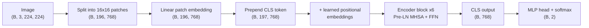
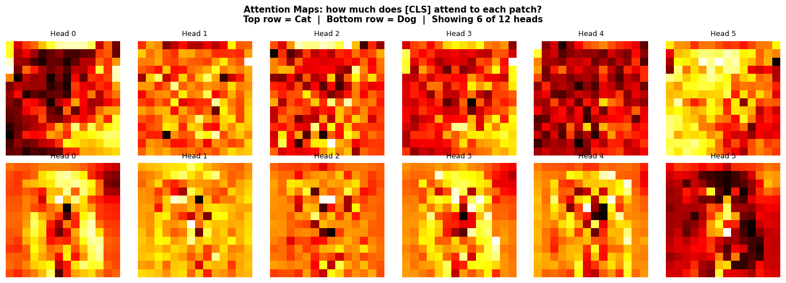

# 05 · Vision Transformer from Scratch

> Every component of a Vision Transformer (patching, embeddings, multi-head self-attention, encoder blocks, classification head) implemented by hand in PyTorch, with the tensor shape traced at every step. A pretrained ViT-B/16 then shows what the same architecture does once it has learned weights.


<sub>How ViT "sees" an image: a 224×224 input becomes a sequence of 196 tokens, one per 16×16 patch.</sub>

## At a glance

| | |
|---|---|
| **What** | A from-scratch ViT forward pass, walked through in 17 steps on a cat image and a dog image |
| **Architecture** | ViT-Base width (d = 768, 12 heads, MLP 3072), 6 encoder layers, 2-class head: **43.8M parameters** (encoder 42.5M, matches the hand count) |
| **Comparison** | torchvision `vit_b_16` with `IMAGENET1K_V1` weights (86.6M parameters, 1000 classes) |
| **Stack** | PyTorch · torchvision · NumPy · Matplotlib · Pillow. Runs on CPU. |

## Architecture and shapes



| Step | Implementation | Shape |
|---|---|---|
| Normalise | ImageNet mean/std per channel | (2, 3, 224, 224) |
| Patchify | `view` → `permute` → `view` (no Conv2d shortcut) | (2, 196, 768) |
| Patch embedding | `nn.Linear(768, 768)` | (2, 196, 768) |
| CLS + positions | learnable `[CLS]` prepended, learnable positional table added | (2, 197, 768) |
| Q, K, V | fused `Linear(768, 2304)`, split into 12 heads of 64 | (2, 12, 197, 64) |
| Attention | $\mathrm{softmax}\!\left(QK^\top/\sqrt{d_k}\right)V$ | weights (2, 12, 197, 197) |
| FFN | `Linear(768→3072)` → GELU → `Linear(3072→768)` | (2, 197, 768) |
| Encoder block | $x \leftarrow x + \mathrm{MHSA}(\mathrm{LN}(x))$, then $x \leftarrow x + \mathrm{FFN}(\mathrm{LN}(x))$ | (2, 197, 768) |
| Head | `LN → Linear(768,768) → GELU → Linear(768,2)` on the CLS token | (2, 2) |

## Key ideas the notebook demonstrates

- **Why patches:** self-attention over raw pixels would mean 50,176 tokens and a 50,176² attention matrix. 16×16 patches reduce this to 196 tokens.
- **Why a CLS token:** it starts with no image content and, through attention, aggregates a global summary that the head classifies.
- **Why positional embeddings:** attention is permutation-invariant. Without positions, a shuffled image looks identical to the model.
- **Why multiple heads:** 12 heads of 64 dimensions attend to different relationships in parallel at the same cost as one 768-dimensional head.


<sub>[CLS]→patch attention for six heads of the <b>untrained</b> model, each panel on its own colour scale. At initialisation, attention is almost uniform (about 1/197 ≈ 0.005 per patch), so these maps mostly show noise. The point is the mechanism, not learned saliency.</sub>

## Random vs pretrained weights

With random weights the pipeline runs end to end but knows nothing. Both images land close to a 50/50 coin flip between *cat* and *dog*. Their CLS vectors still differ, which shows the forward pass is content-dependent even before any training.

Loading torchvision's pretrained **ViT-B/16** (the same family of architecture, with 12 layers and a 1000-class head) turns the same computation into ranked ImageNet predictions. The notebook ends with a side-by-side comparison of random and pretrained outputs. The architecture is identical; the difference is entirely in the learned weights.

## Run it

```bash
pip install -r requirements.txt
cd 05-vision-transformer
jupyter notebook vit_classification.ipynb    # Kernel → Restart & Run All
```

The first run downloads the ViT-B/16 weights (about 330 MB) to the torch hub cache. No GPU is needed.

## Files

```
05-vision-transformer/
├── vit_classification.ipynb   # the full walkthrough
├── cat.png, dog.png           # input images
└── assets/                    # README figures extracted from the notebook
```

## Skills demonstrated

`transformer architecture` · `scaled dot-product & multi-head attention` · `patch embeddings` · `positional encodings` · `Pre-LN residual blocks` · `tensor-shape reasoning` · `parameter accounting` · `PyTorch nn.Module design` · `pretrained models / transfer learning`
