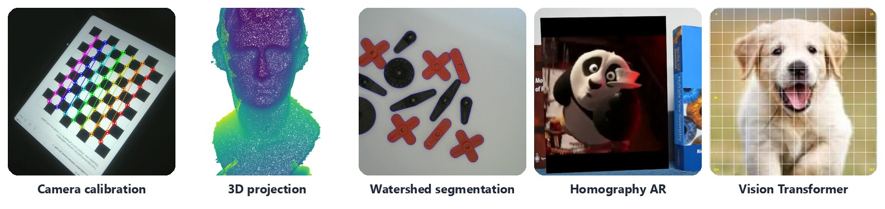
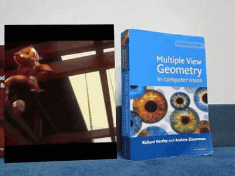
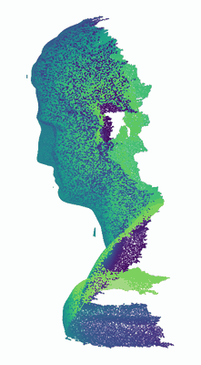
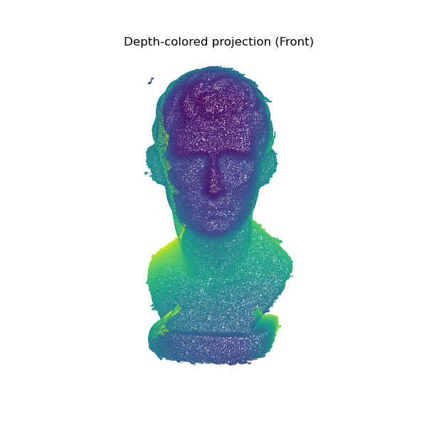
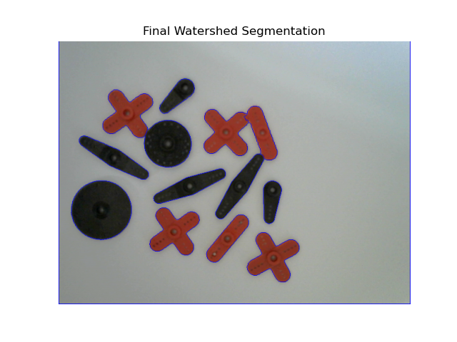
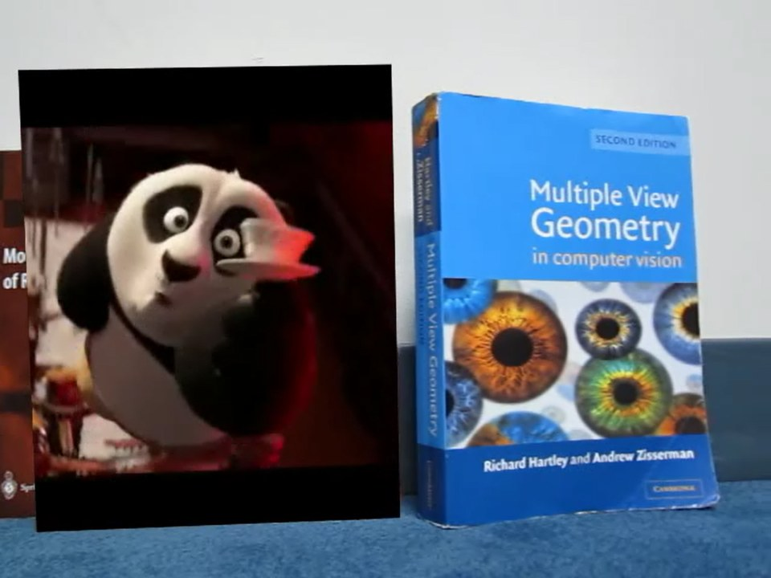
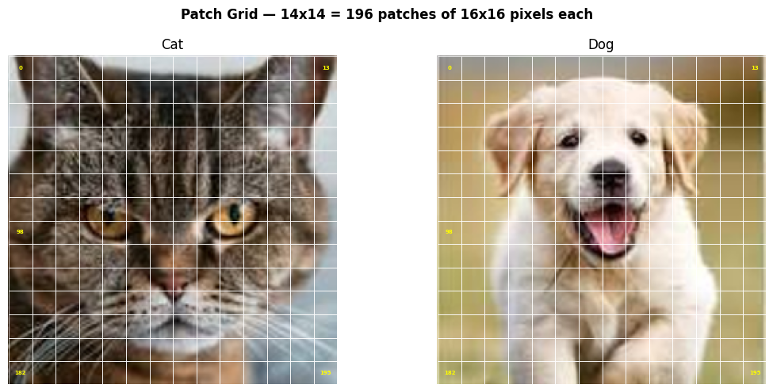
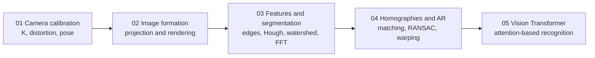

<div align="center">

# Applied Computer Vision

**CMU 18-799 · Carnegie Mellon University Africa · Spring 2026**

From the pinhole camera to Vision Transformers: five projects implementing the core of computer vision from first principles.




</div>

## About

This repository collects my work for **Applied Computer Vision**. Each project implements the underlying math myself (camera models, ray–plane intersection, homographies, RANSAC, watershed, the FFT, attention) instead of calling a single library function, then applies it to a real problem and measures the result.

<table>
<tr>
<td align="center" width="50%"><br><sub><b>Homography-based AR</b>: a movie tracked onto a moving book, using my own DLT + RANSAC</sub></td>
<td align="center" width="50%"><br><sub><b>Virtual pinhole camera</b> orbiting a 314k-point 3D scan, rendered with plain NumPy</sub></td>
</tr>
</table>

## Projects

| | Project | What I built | Highlight |
|:---:|---|---|---|
|  | **[01 · Camera Calibration & ArUco Pose](01-camera-calibration-pose/)** | Interactive capture tool, Zhang calibration with sub-pixel corners, real-time 6-DoF ArUco marker pose via PnP | Webcam calibrated to **1.27 px** RMS reprojection error |
|  | **[02 · Image Formation & 3D Projection](02-image-formation-3d-projection/)** | Ray–plane projection onto standard and tilted planes, a look-at camera rendering 3D scans from six viewpoints, a 360° orbit, perspective vs orthographic, Bayer demosaicing | 2M points projected; my own **3D scan** rendered from six viewpoints |
|  | **[03 · Feature Detection & Segmentation](03-feature-detection-segmentation/)** | Watershed object counting, Hough-based chessboard straightening, FFT image compression, a data-augmentation toolkit | **13/13** touching objects counted (naive baseline: 10/13) |
|  | **[04 · AR with Planar Homographies](04-augmented-reality-homography/)** | FAST/BRIEF matching, normalised DLT, RANSAC, perspective compositing for image and video AR; BRIEF rotation study; face/no-face k-NN | Movie tracked across a **511-frame** hand-held video |
|  | **[05 · Vision Transformer from Scratch](05-vision-transformer/)** | Patch embedding, CLS token, positional embeddings, multi-head self-attention and Pre-LN encoder in PyTorch; comparison with pretrained ViT-B/16 | 43.8M-param ViT, shape-traced end to end |

## Skills demonstrated

| Area | Techniques | Projects |
|---|---|---|
| **Camera geometry** | Pinhole model, intrinsics/extrinsics, Zhang calibration, lens distortion, look-at cameras, PnP pose, perspective vs orthographic projection | 01 · 02 |
| **Projective geometry** | Ray–plane intersection, vanishing and ideal points, homographies, DLT via SVD, Hartley normalisation | 02 · 04 |
| **Robust estimation** | RANSAC, inlier/outlier analysis, reprojection-error diagnostics | 01 · 04 |
| **Features & matching** | FAST, BRIEF, Harris vs FAST, Hamming matching, Lowe ratio test, Canny, Sobel, Hough transform, descriptor invariance analysis | 03 · 04 |
| **Segmentation** | Otsu thresholding, mathematical morphology, distance transform, marker-controlled watershed, contours | 03 |
| **Signal processing** | 2D FFT, spectral filtering, compression and PSNR evaluation, Bayer demosaicing, CLAHE | 02 · 03 |
| **3D vision** | Point-cloud I/O and rendering, depth colouring, 3D scanning (Revopoint), camera orbits | 02 |
| **AR & video** | Perspective warping, mask compositing, frame-by-frame tracking-by-detection, video I/O | 01 · 03 · 04 |
| **Machine learning** | Bag-of-features, k-NN, augmentation, confusion matrix / P / R / F1, leakage analysis | 03 · 04 |
| **Deep learning** | Transformers, multi-head self-attention, patch and positional embeddings, PyTorch modules, pretrained models | 05 |

## Learning path



The projects build on each other. Calibration gives the camera model. Image formation uses it to render 3D data. Classical features detect structure. Homographies combine features and geometry into AR. Learned representations (ViT) close the loop on recognition.

## Repository structure

```
Applied-Computer-Vision-18-799-CMU/
├── 01-camera-calibration-pose/          # scripts + calibration data
├── 02-image-formation-3d-projection/    # notebook, data/, results/, report/
├── 03-feature-detection-segmentation/   # notebook, data/, results/
├── 04-augmented-reality-homography/     # code/, data/, results/, report/
├── 05-vision-transformer/               # notebook
├── assets/                              # README banner
└── requirements.txt                     # union of all project dependencies
```

Each project folder has its own README (method, equations, results, limitations, how to run) and its own `requirements.txt`.

## Getting started

```bash
git clone https://github.com/KoomeMartin/Applied-Computer-Vision-18-799-CMU.git
cd Applied-Computer-Vision-18-799-CMU
python -m venv .venv && source .venv/bin/activate     # Windows: .venv\Scripts\activate
pip install -r requirements.txt
```

Then open any project folder and follow its README. Notebooks and scripts use paths relative to their own project folder.

## Notes

- **Academic integrity.** This is coursework shared as a portfolio. If you are taking 18-799, please follow the course's collaboration policy and don't copy it.
- **Course material.** Some starter utilities (for example `helper.py` and `loadVid.py` in project 04), the provided datasets and the Lab 1 guide came from the course staff. Each project's README identifies what I implemented.
- **Third-party media.** Some input images and video clips (book covers, a film clip, stock and satellite photos) belong to their respective owners and are included only as course inputs for educational use.

## Author

**Martin Koome** · [GitHub @KoomeMartin](https://github.com/KoomeMartin)
